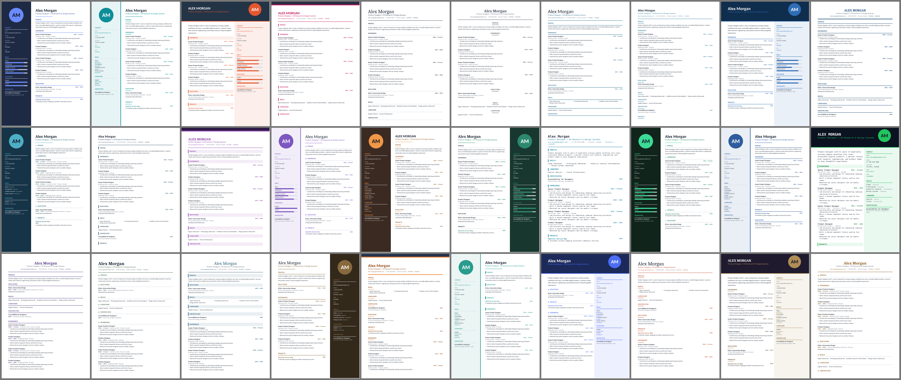

# CV Studio

Build a professional CV and export it as a **PDF** or an **editable Word (.docx)** file. Everything stays on your computer: no account, no cloud, no analytics.

[](../../actions/workflows/tests.yml)
&nbsp;Version 1.0.0 · MIT licence · Windows 10 / 11



## Features
- **30 original templates** in five categories (Modern, Minimal, Professional, Creative, Others) on eight different page structures: sidebars, banners, classic, minimal, bold and compact layouts. An "ATS-friendly" filter shows the single-column ones.
- **PDF** with real, selectable text and embedded fonts, and **Word (.docx)** with real tables, bullet lists and named styles (`CV Name`, `CV Section Heading`, …) so you can keep editing.
- Complete CV editor: personal details, summary, experience, internships, education, courses, projects, publications, awards, volunteer work, memberships, references, skills, languages, certificates, interests, links and custom sections. Hide or reorder sections.
- **Template gallery** with real-size previews of *your* CV, search, categories, favourites, and one-click **USE THIS TEMPLATE**.
- Several CVs for different jobs: save, duplicate, rename, delete, back up and restore.
- A4 or US Letter, accent colour, font size, profile photo (or a monogram when there is none).
- Interface in **English, Français, Español and العربية** (right-to-left), light / dark / system theme.
- Job tools: compare your CV with a job advert and draft a cover letter, offline.
- **Private by design**: no network code at all (a test checks that no networking modules are imported).

## Download (Windows)
Get the latest `CVStudio-…-windows-x64.zip` from the **Releases** page, unzip it and run `CVStudio.exe`.
The app is not code-signed, so Windows SmartScreen may say "Windows protected your PC": choose *More info → Run anyway*.

## Run from source
Requires Python 3.10+ (developed and tested with 3.12).
```bash
git clone <this repository>
cd cv-studio
python -m venv .venv
.venv\Scripts\activate          # macOS/Linux: source .venv/bin/activate
pip install -r requirements.txt
python -m cvstudio
```

## Build the Windows app yourself
```powershell
.\build_exe.ps1            # one-folder build  -> dist\CVStudio\CVStudio.exe  (recommended)
.\build_exe.ps1 -OneFile   # single exe        -> dist\CVStudio.exe
```
Pushing a tag like `v1.0.0` makes GitHub Actions build the zip and attach it to a Release (`.github/workflows/release.yml`).

## Where your data lives
| What | Windows location |
|---|---|
| CVs | `%APPDATA%\CVStudio\profiles.sqlite3` (automatic copies in `backups\`) |
| Settings (language, theme, favourites) | `%APPDATA%\CVStudio\settings.json` |
| Template thumbnails (cache) | `%APPDATA%\CVStudio\cache\` |

Exported PDF/Word files go exactly where you save them. *Settings → Save a backup copy…* writes a `.cvbackup` file you can restore later. (macOS/Linux use `~/Library/Application Support/CVStudio` and `~/.local/share/CVStudio`.)

## Tests
```bash
python -m unittest discover -s tests -v
```
They cover the templates, PDF and Word export, storage, translations and GUI logic (with a Qt stand-in). Real window rendering is checked by hand. See [LIMITATIONS.md](LIMITATIONS.md).

## Project layout
```
cvstudio/        application code (PySide6 GUI, PDF/Word engine, storage, translations)
  assets/        icon and bundled fonts (with their licences)
tests/           unit tests
tools/clean.py   removes __pycache__, build output, ...
docs/            images; docs/development has developer reports
examples/        a fictional sample CV (JSON)
```

## Contributing, security, licence
- [CONTRIBUTING.md](CONTRIBUTING.md) · [SECURITY.md](SECURITY.md) · [CHANGELOG.md](CHANGELOG.md)
- Licensed under the [MIT licence](LICENSE). Third-party components (PySide6/Qt under LGPL-3.0, ReportLab, python-docx, Pillow, and the Carlito, Caladea and DejaVu Sans Mono fonts) are listed in [NOTICE.md](NOTICE.md).
